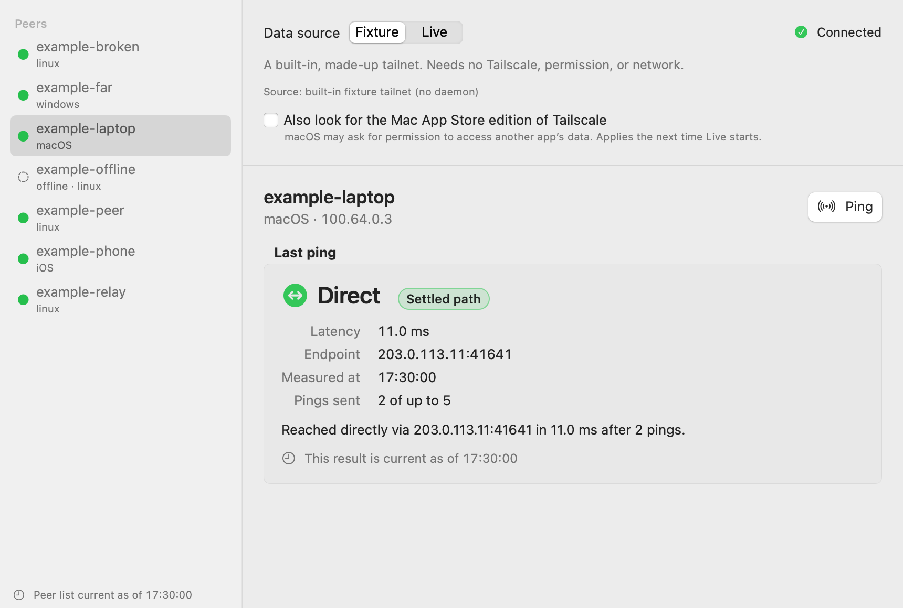

# Peer Diagnostics

A small Mac app built on
[swift-tailscale-client](https://github.com/dweekly/swift-tailscale-client) (unofficial; not
affiliated with Tailscale Inc.). It lists the peers your existing Tailscale installation
knows about and, for the peer you pick, says how a ping reached it: directly, through a
peer relay, through DERP, or by a path the daemon did not name. Every result carries the
time it was measured and whether it is still current.

Requirements: macOS 13 or later and Swift 6.1 or later. Fixture mode needs no Tailscale
installation.

## Try it

From the repository root:

```bash
swift run --package-path Examples/PeerDiagnostics PeerDiagnostics
```

The window opens in **fixture mode**, a built-in, made-up tailnet, with `example-laptop`
selected. Press **Ping** (or Return) to run a burst; quit with Command-Q or by closing the
window.

<picture>
  <source media="(prefers-color-scheme: dark)" srcset="../../Sources/TailscaleClient/TailscaleClient.docc/Resources/peer-diagnostics-window~dark.png">
  
</picture>

To use the Tailscale daemon already running on this Mac, choose **Live** in the window (or
start with `--live`). Live mode reads status, pings the peer you select, and watches the
daemon's event bus for changes. It never writes to the daemon or changes a Tailscale
setting.

The same answers without a window:

```bash
swift run --package-path Examples/PeerDiagnostics PeerDiagnostics --fixture --print
swift run --package-path Examples/PeerDiagnostics PeerDiagnostics --live --print
```

The fixture peers each show one outcome: `example-peer` (direct), `example-laptop` (DERP,
then direct), `example-relay` (peer relay), `example-far` (always DERP), `example-phone` (no
path named), `example-offline` (no reply), and `example-broken` (daemon error).

## Reading a result

| Label | Meaning |
|---|---|
| **Direct** | The reply came straight from the peer. The endpoint is the address it answered from. |
| **Peer relay** | The reply came through another node in your tailnet acting as a relay. |
| **DERP** *code* | The reply came through a Tailscale DERP relay server in that region, such as `sfo`. A first ping often goes this way while a direct route is still being found. |
| **Unknown** | The peer answered, but the reply did not name a path. |
| **Failed** | No reply within 5 seconds, or the daemon reported an error. The text says which. |

Beside the path is a verdict. **Settled path** appears only when a ping was answered
directly. **One measurement** means the burst ended on a DERP or relayed reply: it says how
that ping travelled, not where the peer will settle. **Still pinging** appears while a burst
runs.

A burst sends up to 5 pings one second apart and stops at the first direct reply, the first
failure, or the fifth ping. The spacing and the 5-second timeout match the official
`tailscale ping`; the count is half of its 10.

**Stale** means the data may no longer describe the present. The peer list and the ping
result each carry their own label. The peer list goes stale while the connection to the
daemon is down. A ping result goes stale after 30 seconds or as soon as the connection
drops, and only a new ping makes it current again; a refreshed peer list never does.

## The Mac App Store edition of Tailscale

Live mode finds the standalone Tailscale app and `tailscaled` without asking for anything.
To also find the Mac App Store edition, tick **Also look for the Mac App Store edition of
Tailscale** (or pass `--allow-app-store-discovery`). macOS may then ask for permission to
access another app's data. The option is off by default and applies the next time Live
starts.

## The screenshot

The pictures above are drawn offscreen from the same view the window shows, in fixture mode,
with the clock frozen at 17:30:00 UTC, so each file is identical on every run:

```bash
swift run --package-path Examples/PeerDiagnostics PeerDiagnostics --fixture \
  --snapshot Sources/TailscaleClient/TailscaleClient.docc/Resources/peer-diagnostics-window.png
swift run --package-path Examples/PeerDiagnostics PeerDiagnostics --fixture --appearance dark \
  --snapshot "Sources/TailscaleClient/TailscaleClient.docc/Resources/peer-diagnostics-window~dark.png"
```

They show the window's content only: macOS draws the title bar and toolbar, and the
selected row has the gray of an inactive window.

## How it is built, and how to test your own code this way

- `PeerDiagnosticsCore` holds all state and logic: `PeerDiagnosticsModel` (an
  `ObservableObject`), the `DaemonConnection` protocol with live and fixture
  implementations, and the text the window shows.
- `PeerDiagnosticsUI` holds the SwiftUI views, which only read the model, and the snapshot
  renderer.
- `PeerDiagnostics` is the command: the window, `--print`, or `--snapshot`.

The tests need no daemon. `DiagnosticsEnvironment` replaces the daemon, the clock, and every
wait, so a test can script a DERP reply followed by a direct one, a disconnect, or a reply
that arrives after the user picked another peer, and check what the model shows. The live
connection's tests use `MockTransport` from the library's `TailscaleClientMocks` product.

```bash
swift test --package-path Examples/PeerDiagnostics
```

The package depends on the library through `.package(path: "../..")`. To use it as a
template, replace that with the released package URL.
